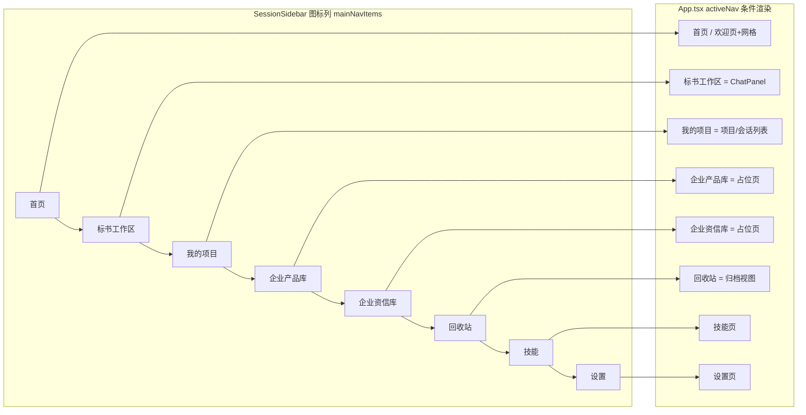

# 标书系统前端壳改造设计方案：侧边栏结构与首页背景网格

## 1. 设计定位与阅读说明

本文解决：把当前通用 JiuwenSwarm Web 前端改造为"标书系统"形态的壳——左侧边栏按标书域重组（A 方案）、首页欢迎页加网格背景（C+D 组合）。范围为**纯前端壳改造**：后端、对话、标书解析、技能链路零改动，用户仍通过现有聊天面板上传标书并解析。推荐阅读顺序：§2 背景与目标 → §4 方案与决策 → §5 详细设计 → §8 验证设计。管理字段在 frontmatter 唯一维护；实施与验证证据由 features 归档，不回填本文。

## 2. 背景、目标与范围

### 2.1 背景与问题

当前前端是通用 Agent 平台形态：左侧为「窄图标列 + 会话/项目列表列」双列侧边栏，一级入口含 对话/专家/技能/扩展/定时任务/频道/设置/更新 等（`components/SessionSidebar/index.tsx` 的 `mainNavItems`，第 86–95 行），主区空态为欢迎页（`components/ChatPanel/index.tsx` 的 `chat-welcome` 分支）。对"标书系统"场景，这些信息架构与标书域不符，且欢迎页无背景网格。

已核实事实（2026-10-27 调研）：

- 侧边栏一级入口数据来源是静态数组 `mainNavItems`（`SessionSidebar/index.tsx:86–95`），key 枚举 `SidebarNavKey` 在 `utils/frontendPlatform.ts:3–15`；页面切换不用 React Router，为 `App.tsx` 的 `activeNav` state + 条件渲染（`handleNavigate` 第 3984–4027 行），会话级为自研 history 路由（`multi-session/routing/useChatRoute.ts`）。
- 欢迎页是 `ChatPanel` 内空态分支（`chat-welcome`，`ChatPanel/index.tsx:2811+`），样式 `.chat-welcome` 在 `ChatPanel.css:4205–4214`，当前无背景；可见背景由 App 布局层祖先提供（`.chat-layout__surface` / `.content` / `.shell` / `body`）。
- 颜色唯一主题文件：`styles/themes/default/light.css`（仅 default/light 一套，无 dark）；硬约束：业务组件禁写死颜色，CSS 用 `var(--color-*)`，新颜色按用途命名加到主题文件。
- i18n 文案：`i18n/locales/zh.json`、`en.json` 的 `nav.*` 节点，新增用户可见文案须中英双语齐全。

问题：缺少标书域的信息架构（标书工作区/企业产品库/企业资信库等）与首页背景网格。

### 2.2 目标与关键场景

| 场景 / 触发条件 | 当前行为 | 目标行为 / 可观察变化 |
| --- | --- | --- |
| 打开应用看左侧栏 | 通用 Agent 入口（对话/专家/技能/扩展/定时任务/频道/设置/更新） | 一级图标列标书域入口：首页 / 标书工作区 / 我的项目 / 企业产品库 / 企业资信库 / 技能 / 设置；列表列内新增「回收站」入口 |
| 无会话打开首页 | 欢迎页纯色无网格；欢迎语"你好，我是WorkSwarm，很高兴认识你！" | 欢迎页显示「细网格 + 粗网格中心渐隐 + 顶部光晕」背景（C+D）；欢迎语改"你好，这里是AI标书系统"（双语） |
| 点击「标书工作区」 | （原名"对话"）进入聊天面板 | 进入现有聊天面板，可上传标书解析，行为不变 |
| 点击「企业产品库 / 企业资信库」 | 入口不存在 | 进入占位页（空态 + "功能规划中"），后端零改动 |
| 点击「我的项目」 | （原项目/会话列表） | 进入现有项目+会话列表，行为不变，文案改为标书域 |
| 点击「回收站」 | 归档在列表列菜单内 | 列表列内新增「回收站」入口，进入归档/回收视图，行为不变 |
| 切到 skills / settings | 技能页 / 设置页 | 保留，入口文案可能微调 |
| 专家/扩展/定时/频道/个人上下文等 | 一级入口可见 | 一级入口隐藏（功能代码保留，仅不展示） |

### 2.3 本次范围与非目标

- 本次包含：侧边栏一级入口信息架构重组（A 方案）；首页欢迎页网格背景（C+D）；欢迎语改标书域文案（双语）；新增 企业产品库/企业资信库 两个占位页；i18n 中英文案补齐；`data-testid` 按规范标注。
- 本次不包含：
  - 产品库/资信库的真实业务页面与存储（占位页即可，后续单独立项）；
  - 标书解析流程的前端轻定制（上传引导、解析结果结构化展示等，属后续"壳+解析体验"范围）；
  - 后端、Gateway、AgentServer、技能逻辑的任何改动；
  - 移动端适配（沿用现有响应式，不新增移动端专属布局）；
  - 新增加载性能优化（代码分割等）。

### 2.4 术语与上下文

- **壳改造**：仅调整信息架构、文案与视觉背景，不改功能逻辑。
- **标书工作区**：现有 `ChatPanel` 聊天面板在标书域的语义名。
- **占位页**：空态页面，仅说明"功能规划中"，用于建立信息架构与导航闭环。
- **C+D 网格**：C = 粗网格 + 中心渐隐；D = 细网格 + 顶部光晕。组合 = 细网格底 + 粗网格中心渐隐 + 顶部品牌色光晕（以 §5 详细设计为准）。

## 3. 设计约束、假设与待决问题

- 已确认约束与依赖：
  - 颜色只用 `var(--color-*)` 语义变量；新颜色按用途命名加到 `styles/themes/default/light.css`，深浅模式（若后续补 dark）需同步。
  - 新增用户可见文案须在 `zh.json` 与 `en.json` 双语齐全（`nav.*` 等节点）。
  - 新增/改动的 UI 元素按 web AGENTS 规范加 `data-testid`（前缀映射表登记新模块前缀）。
  - 页面切换机制不用 React Router，走 `App.tsx` 的 `activeNav` + `handleNavigate`；新 key 需加入 `SidebarNavKey`（`frontendPlatform.ts`）。
  - SVG 图标用 `?react` 导入，`fill/stroke="currentColor"`，多实例渐变/遮罩用 `useId()`。
  - 仓库约束：不运行格式化与静态检查工具；测试走 Node 测试运行器（`npm run test:*`）与 `make test`。
- 关键假设：
  - A1：侧边栏保持现有「窄图标列 + 列表列」双列骨架不变（仅换内容与文案），不重排为单列。若用户希望单列需重评布局（见 Q1）。
  - A2：欢迎页网格只作用于 `chat-welcome` 空态层（最小半径），不铺到所有聊天页；若希望全局主区背景则改 App 布局层（见 Q2）。
  - A3：占位页仅空态文案，不接任何数据接口。
- 待决问题：
  - Q1：侧边栏是保持现有双列骨架，还是改为单列（纯一级菜单 + 下方列表）？——本文按 A1 双列骨架设计。
  - Q2：网格是否只作用于欢迎页，还是整个主区？——本文按 A2 欢迎页设计。
  - Q3：「回收站」入口放在一级图标列，还是列表列内（现有归档在列表列菜单内）？——本文按"列表列内新增回收站入口、复用归档视图"设计。
  - Q4：「我的项目」与现有项目/会话列表是同义入口还是需额外过滤（如只看标书项目）？——本文按同义入口设计。

## 4. 总体方案与设计取舍

### 4.1 方案概览

在 `SessionSidebar` 的 `mainNavItems` 上重排一级入口为标书域结构，新增两个占位页 key 并在 `App.tsx` 加条件渲染分支；在 `ChatPanel.css` 的 `.chat-welcome` 上叠加网格背景（细网格 + 粗网格中心渐隐 + 顶部光晕），新增按用途命名的主题变量；全部文案经 i18n 双语。



箭头含义：侧边栏入口 → `setActiveNav(key)` → 主区条件渲染对应页面。列表列（项目/会话）行为不变。

### 4.2 关键决策

#### D-01 侧边栏按 A 方案重组为标书域一级入口

- 选择与依据：贴近参考站（链企AI 货物标：工作区 / 产品库 / 资信库 / 标书写作）的信息架构，同时保留解析能力（工作区=现有聊天面板、技能保留）。隐藏与标书无关的一级入口（专家/扩展/定时/频道/个人上下文/实验等），功能代码保留仅 UI 不展示，降低回归风险。
- 代价与成立条件：占位页是空态，需后续立项接真实业务；隐藏入口若未来需要可加回（改 `hiddenNavItems` 或平台配置）。
- 实现体现：I-01/I-02/I-04；验证 D-V-01。
- 相关候选：R-01、R-02。

#### D-02 首页网格采用 C+D 组合（细网格 + 粗网格中心渐隐 + 顶部光晕）

- 选择与依据：C 的"中心留白聚焦输入区"与 D 的"顶部光晕层次"叠加，视觉聚焦与品牌感兼顾；纯 CSS 渐变实现，无图片资源，性能好且可主题化。
- 实现形态（已与用户确认）：三层叠加——① 细网格底（24px，D）；② 粗网格中心渐隐（48px + `mask-image` 径向渐隐，C，经 `::before` 伪元素叠加）；③ 顶部品牌色光晕（radial-gradient，D）。`mask-image` 双写 `-webkit-` 前缀覆盖 Chrome 107+，`pointer-events:none` 不挡输入；`.chat-welcome` 补 `position: relative`。
- 代价与成立条件：新增 2 个按用途命名的主题变量 `--color-grid-line`（网格线）、`--color-grid-glow`（顶部光晕），深浅模式后续同步；色阶与网格尺寸在实现后按视觉走查微调。
- 实现体现：I-03/I-05；验证 D-V-02。
- 相关候选：R-02、R-03。

#### D-03 占位页零后端，仅空态文案

- 选择与依据：本次为壳改造，占位页用于建立导航闭环与信息架构，不接接口，最小改动。
- 代价与成立条件：用户点击后无实际功能，需在文案中明确"功能规划中"；后续接业务时替换组件实现。
- 实现体现：I-02；验证 D-V-03。
- 相关候选：无（占位页是唯一合理选择）。

#### D-04 欢迎语改标书域文案（仅 i18n，组件逻辑不动）

- 选择与依据：欢迎语组件 `WelcomeHeading` 渲染 `chat.welcomeHeading`；仅改 i18n 文案即可换标书域语义，零组件改动。文案经用户确认为"你好，这里是AI标书系统"，英文为 "Hi, this is the AI Bid System."。
- 代价与成立条件：若该 key 在组创建欢迎等其他分支复用，需核对影响面（见 §6.1 旧调用核对）。
- 实现体现：I-06；验证 D-V-06。
- 相关候选：无。

### 4.3 替代方案与排除理由

| 候选 / 关联决策 | 候选目的与关键差异 | 拒绝或暂缓原因 | 重新评估条件 |
| --- | --- | --- | --- |
| R-01 / D-01：侧边栏改单列 | 更简洁的一级导航 | 改动现有双列骨架，布局重构面大、回归风险高 | 用户明确要单列 |
| R-02 / D-02：网格用图片背景 | 视觉更精细 | 图片资源不可主题化、加载性能差，违反"不写死颜色" | 视觉要求远超 CSS 表达能力 |
| R-03 / D-02：网格铺到全局主区（App 布局层） | 所有页面统一背景 | 影响聊天/设置等所有页面，半径过大 | 用户明确要全局网格 |

## 5. 详细设计

### 5.1 模块责任与关键不变量

| 模块 | 承担 | 不承担 |
| --- | --- | --- |
| `components/SessionSidebar/index.tsx` | 一级入口数组重排与隐藏项过滤 | 页面内容渲染 |
| `utils/frontendPlatform.ts` | `SidebarNavKey` 新增 key、按平台隐藏配置 | 页面逻辑 |
| `App.tsx` | `activeNav` 条件渲染新分支（占位页）、导航副作用 | 侧边栏内部结构 |
| `components/ChatPanel/ChatPanel.css` | 欢迎页网格背景样式 | 欢迎页结构与文案逻辑 |
| `styles/themes/default/light.css` | 新增网格线/光晕语义变量 | 主题切换逻辑 |
| `i18n/locales/zh.json`、`en.json` | 标书域文案双语 | 文案渲染逻辑 |
| 新增 `features/tender/PlaceholderLibraryPage.tsx` | 产品库/资信库占位页 | 真实业务数据 |

关键不变量：

- INV-1（壳）：后端、对话、技能、解析链路零改动；标书解析仍走现有聊天面板上传。
- INV-2（隐藏不删除）：被隐藏的一级入口仅 UI 不展示，代码与路由保留，可通过配置恢复。
- INV-3（主题化）：网格与光晕颜色只经 `var(--color-*)` 语义变量，不写死；深浅模式可适配。
- INV-4（i18n）：新增用户可见文案双语齐全。
- INV-5（可测）：新增/改动元素按规范加 `data-testid`。

### 5.2 关键类与函数设计

#### 5.2.1 关键结构与样式定义

| 项 / 所属模块 | 变更类型与可见范围 | 职责与边界 | 组合关系 |
| --- | --- | --- | --- |
| `mainNavItems` / `SessionSidebar/index.tsx` | 修改 | 一级入口数组，重排为标书域 | 消费 `NavItem` 类型与 `SidebarNavKey` |
| `SidebarNavKey` / `utils/frontendPlatform.ts` | 修改 | 复用现有 `chat / skills / settings`；新增 `home / productLibrary / qualificationLibrary`（「标书工作区」复用 `chat` key，仅改文案；「我的项目」复用项目/会话列表展示） | 被 `SessionSidebar`、`App.tsx`、`MainNavKey` 消费 |
| `PlaceholderLibraryPage` / `features/tender/PlaceholderLibraryPage.tsx` | 新增；内部 | 产品库/资信库占位页组件（空态图标 + 文案） | 被 `App.tsx` 条件渲染 |
| `.chat-welcome` / `ChatPanel.css` | 修改 | 叠加网格背景（background-image 多值） | 消费新主题变量 |
| 新主题变量 / `light.css` | 新增 | `--color-grid-line`、`--color-grid-glow`（按用途命名，最终名以主题文件命名习惯为准） | 被 `.chat-welcome` 消费 |

#### 5.2.2 关键样式草案（目标设计，非最终实现）

欢迎页网格（`.chat-welcome` 叠加层）：

```css
.chat-welcome {
  /* 既有 flex 居中布局保持不变；以下为新增背景 */
  background-color: var(--color-surface-card); /* 沿用卡片底，不写死 */
  background-image:
    radial-gradient(ellipse 60% 50% at 50% 0%, var(--color-grid-glow), transparent 70%),
    linear-gradient(var(--color-grid-line) 1px, transparent 1px),
    linear-gradient(90deg, var(--color-grid-line) 1px, transparent 1px);
  background-size: 100% 100%, 24px 24px, 24px 24px;
}
/* 粗网格中心渐隐（可选叠加层，用伪元素 + mask） */
.chat-welcome::before {
  content: '';
  position: absolute;
  inset: 0;
  background-image:
    linear-gradient(var(--color-grid-line) 1px, transparent 1px),
    linear-gradient(90deg, var(--color-grid-line) 1px, transparent 1px);
  background-size: 48px 48px;
  -webkit-mask-image: radial-gradient(ellipse 70% 80% at 50% 45%, transparent 30%, #000 100%);
  mask-image: radial-gradient(ellipse 70% 80% at 50% 45%, transparent 30%, #000 100%);
  pointer-events: none;
}
```

说明：网格为"细网格底（24px）+ 粗网格中心渐隐（48px + mask）+ 顶部光晕（radial-gradient）"三层叠加；`mask-image` 兼容 Chrome 107+（含 `-webkit-` 前缀）。具体色值与尺寸在实现时按主题变量与视觉走查微调。

### 5.3 接口定义与消息契约

无跨模块接口契约变化。新增前端内部：

| 项 | 消费者 | 输入与结果 | 失败语义 |
| --- | --- | --- | --- |
| `SidebarNavKey` 新 key | `SessionSidebar`、`App.tsx` | 字符串 key，导航切换 | 非法 key 不渲染（沿用现有兜底） |
| `nav.home / nav.tenderWorkspace / ...` i18n key | `SessionSidebar` 渲染 | 返回双语 label | 缺失时回退 key 字符串（i18n 兜底） |
| `data-testid` | 测试 | 侧边栏入口 `session-sidebar-nav-item-<key>`；占位页根 `tender-placeholder-<library|qualification>`；欢迎页沿用 `chat-panel-welcome` | 不影响功能 |

### 5.4 配置与能力控制

无新增配置项。隐藏入口沿用现有 `hiddenNavItems` / `HIDDEN_NAV_ITEMS_BY_PLATFORM` 机制；如需按构建开关控制标书壳，可后续加 feature flag（本次不做）。

### 5.5 数据模型与事实归属

无持久化数据变化。占位页无数据；会话/项目数据沿用现有存储。

### 5.6 状态机与生命周期

无状态机变化。`activeNav` 状态流转沿用现有 `handleNavigate`。

### 5.7 正常执行流程

1. 用户打开应用，默认进入「首页」（欢迎页，无会话），`.chat-welcome` 渲染网格背景。
2. 点击「标书工作区」→ `setActiveNav` → 渲染 ChatPanel，可上传标书解析。
3. 点击「我的项目」→ 渲染项目/会话列表。
4. 点击「企业产品库 / 企业资信库」→ 渲染占位页。
5. 点击「回收站」→ 渲染归档视图。
6. 点击「技能 / 设置」→ 渲染技能页 / 设置页。

### 5.8 异常、中断与重试处理

- 占位页无数据请求，无失败路径；若未来接接口，沿用现有页面错误态。
- i18n 缺失时回退 key 字符串；主题变量缺失时浏览器回退为无网格（背景透明），不影响功能。

### 5.9 并发与一致性

无共享状态或并发问题。

### 5.10 持久化与恢复

无持久化变化；导航状态沿用现有会话恢复逻辑。

### 5.11 按需专项设计

- 资源与文件布局：新增图标放 `src/assets/`（`?react` 导入、`currentColor`）；占位页组件放 `features/tender/`。
- 安全与授权边界：无；前端壳不涉及权限。
- 交互与观测：侧边栏入口、占位页、欢迎页网格区域按规范加 `data-testid`，供 UI 自动化定位。

## 6. 影响面与实施设计

### 6.1 修改点与实施顺序

| 实施项 | 模块 / 文件或符号 | 修改内容与责任 | 必要前置 / 独立验证产物 |
| --- | --- | --- | --- |
| I-01 | `utils/frontendPlatform.ts` | `SidebarNavKey` 新增 `home/productLibrary/qualificationLibrary`（复用 chat/skills/settings）；隐藏项配置 | 无 |
| I-02 | `features/tender/PlaceholderLibraryPage.tsx`（新增） | 占位页组件（空态 + 文案） | I-01 |
| I-03 | `styles/themes/default/light.css` | 新增网格线/光晕语义变量 | 无 |
| I-04 | `SessionSidebar/index.tsx` | `mainNavItems` 重排 + 隐藏项过滤 + 新图标导入 | I-01、I-03 |
| I-05 | `ChatPanel.css` | `.chat-welcome` 网格背景叠加 | I-03 |
| I-06 | `i18n/locales/zh.json`、`en.json` | `nav.*` 与占位页文案双语；`chat.welcomeHeading` 改"你好，这里是AI标书系统" / "Hi, this is the AI Bid System." | 无 |
| I-07 | `App.tsx` | 新 key 的条件渲染分支 + 导航副作用 | I-01、I-02 |
| I-08 | `src/assets/` 新增图标 SVG | 首页/工作区/项目/产品库/资信库/回收站图标 | 无 |
| I-09 | 前端测试 | 侧边栏结构、占位页、欢迎页网格的既有/新增测试适配 | 全部 |

实施顺序：I-01 → I-03 / I-06 / I-08（可并行）→ I-04 → I-05 → I-02 → I-07 → I-09。

旧调用核对：`activeNav` 默认值与既有 key 的行为需保持不变；被隐藏入口的路由与状态保留（INV-2）。

### 6.2 文档同步

- spec：前端无正式 S 契约变化；若后续把侧边栏结构固化为契约，再补 specs。
- 架构 / 模块约定：`jiuwenswarm/channels/web/frontend/AGENTS.md` 的颜色/i18n/SVG 规则已在本设计中遵守，无需修订。
- 开发计划：无既有计划条目；实施与验收证据由本设计关联的 F 文档维护。
- 其他入口：`docs/zh`、`docs/en` 的页面概览文档可在实施完成后补充标书壳说明（非本次必须）。

## 7. 兼容与迁移

- 影响对象：现有用户的一级入口习惯；既有测试中对 `nav.*` 文案或侧边栏结构的断言。
- 处理策略：隐藏入口仅 UI 层，路由与代码保留，可配置恢复（INV-2）；既有测试断言若因文案/结构变化失败，在实施项 I-09 中适配。
- 必要步骤与失败处置：无迁移步骤；失败仅需回退前端分支。
- 回退边界：纯前端改动，回退代码即完全回退，无数据/协议不可回退项。

## 8. 验证设计与通过条件

| 验证 ID | 场景 / 前置状态与输入 | 操作或验证入口 | 预期结果 / 通过条件 | 验证层级与环境 |
| --- | --- | --- | --- | --- |
| D-V-01 | 打开应用看侧边栏 | 启动 Web UI 观察一级入口 | 显示标书域入口（首页/标书工作区/我的项目/企业产品库/企业资信库/回收站/技能/设置），隐藏专家/扩展/定时/频道等 | UI e2e / 手测（Chrome 107+） |
| D-V-02 | 无会话打开首页 | 进入欢迎页 | 显示细网格 + 粗网格中心渐隐 + 顶部光晕背景；输入区聚焦 | UI e2e / 视觉走查 |
| D-V-03 | 点击企业产品库/资信库 | 侧边栏点击 | 进入占位页，显示"功能规划中"空态 | UI e2e / 单测 |
| D-V-04 | 标书工作区解析 | 进入工作区上传标书 | 走现有聊天解析链路，行为与现状一致 | 回归（现有解析测试） |
| D-V-05 | 我的项目 / 回收站 | 侧边栏点击 | 进入现有项目/会话列表与归档视图，行为不变 | 回归 |
| D-V-06 | i18n | 切换中英文 | 新增入口与占位页文案双语完整 | 单测 / 手测 |
| D-V-07 | 主题适配 | 浅色模式（及若后续深色） | 网格/光晕颜色用语义变量，无色值写死 | 代码走查 + 视觉走查 |
| D-V-08 | 既有测试回归 | 运行 `npm run test:*` 与相关单测 | 全绿；侧边栏/会话列表相关断言适配后通过 | 单测 / Node 测试运行器 |

## 9. 设计风险与已知限制

### 9.1 设计风险

| 风险 / 触发条件 | 对本次方案的影响 | 已有应对措施 | 核实或验证方式 |
| --- | --- | --- | --- |
| 侧边栏双列骨架被期望改为单列 | D-01 结构不符 | 待决 Q1 明确；当前按双列骨架 | 用户确认 |
| 网格期望全局而非仅欢迎页 | D-02 半径不符 | 待决 Q2 明确；当前按欢迎页 | 用户确认 |
| 既有测试对侧边栏/文案断言较多 | I-09 适配量 | 回归门禁 D-V-08 | 运行测试 |

### 9.2 已知设计限制

- 占位页无真实业务功能。
- 未做解析体验轻定制（属后续范围）。
- 深色主题未覆盖（当前仅 light 一套主题）。
- 移动端无专属适配（沿用现有响应式）。

## 10. 按日期记录的评审与设计修订

| 日期 | 评审人 / 确认方 | 评审或修订主题 | 结论 | 修改与依据 |
| --- | --- | --- | --- | --- |
| 2026-10-27 | （创建，尚无评审） | 初稿 | 待评审 | 基于代码调研与用户确认的 A 方案、C+D 网格、纯前端壳范围形成 |
| 2026-10-27 | 用户 | 第 2 段细化：网格实现与欢迎语文案 | 确认 | 网格三层叠加方案确认；欢迎语定"你好，这里是AI标书系统"，据此补充 D-02 实现形态、D-04、I-06 与 §2.2 场景表 |
| 2026-10-27 | 用户 | 整体设计与待决项 Q1–Q4 口径 | 批准 | Q1 双列骨架、Q2 仅欢迎页、Q3 列表列内回收站、Q4 同义入口全部按设计口径确认，设计批准进入开发 |

## 11. 参考与交接

- 关联设计、架构和 spec：本仓 designs 索引中无前端壳/标书域既有设计，本设计为独立新决策；前端规则依据 `jiuwenswarm/channels/web/frontend/AGENTS.md` 与 `jiuwenswarm/channels/web/AGENTS.md`（data-testid 规范）。
- 开发交接：已确认范围（待用户评审确认后推进状态）、关键决策 D-01..D-03、待决问题 Q1..Q4、验收场景 D-V-01..D-V-08、实施顺序 I-01..I-09；解析链路回归以 INV-1/D-V-04 为门禁。
- 关联实施归档：尚无。
