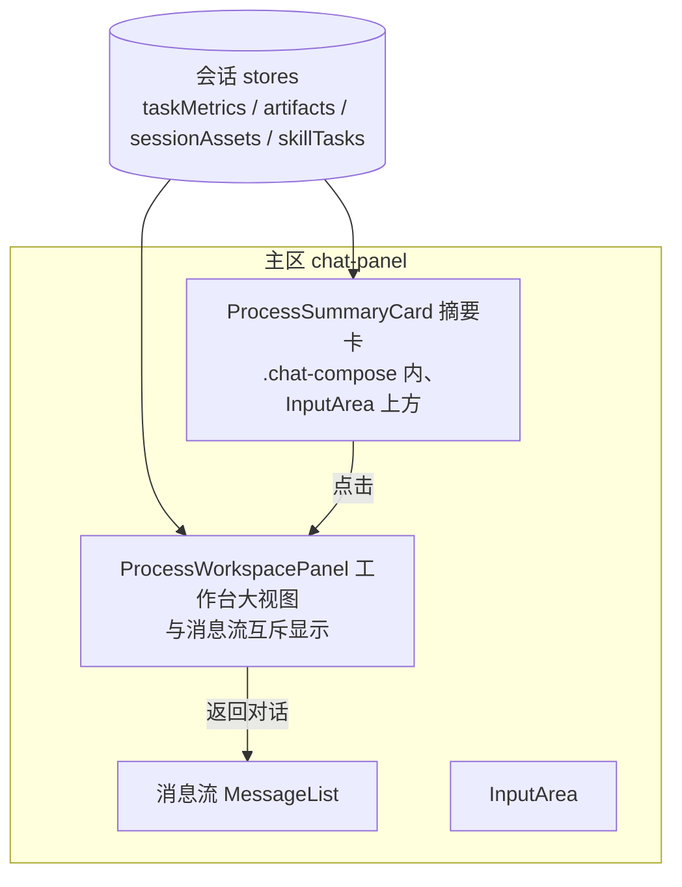

# 标书解析过程信息内嵌设计方案：进度/素材/参考/产物并入对话主区

## 1. 设计定位与阅读说明

本文解决：标书解析任务执行时，进度、素材、参考信息、产物四类过程信息当前展示在右侧栏（ToolPanel），用户要求改为标书解析页面（对话主区）的一部分。经方案比选确认采用 **A+B 混合**：消息流内（输入框上方）放轻量摘要卡，点击摘要在主区就地展开大视图。推荐阅读顺序：§2 背景与目标 → §4 方案与决策 → §5 详细设计 → §8 验证设计。管理字段在 frontmatter 唯一维护；实施与验证证据由 features 归档，不回填本文。

## 2. 背景、目标与范围

### 2.1 背景与问题

当前前端执行任务（标书解析）时，过程信息全部承载于主工作区右列的 `ToolPanel`（`App.tsx:4643-4671`，带可拖拽分割线）：

- **进度**：planning tab，组件 `teamArea/TaskPlanningPanel.tsx`，数据来自 `useTaskPlanningMetrics()`（team 模式）与 `todoStore`（单 agent 模式）。
- **素材**：`features/sessionAssets/SessionAssetList.tsx`，数据 `useSessionAssetsStore(selectSessionAssets(sessionId))`。
- **产物**：artifacts tab，数据 `useSessionArtifacts()` / `useSessionArtifactsCount()`（`components/ArtifactsPanel`），大预览为 `teamArea/ExpandedPanel.tsx` 内的 `ArtifactExpandedPanel`。
- **参考信息**：references 区块，`skillTasks` 由消息 `msg.skills` 与 `toolExecutions` 中的 skill_tool 调用推导（`ToolPanel/index.tsx:211-229`）。

已核实事实（2026-10-28 调研）：

1. 四类信息的数据全部来自会话级 store/hooks，与渲染位置解耦，迁移布局不需要动数据链路。
2. 对话主区已有「输入框上方活动卡」插槽先例：`.chat-compose` 内 `InputArea` 之上依次渲染 `ActiveTeamGroupEntry`（团队活动卡）、`AgentActivityCard`（单 agent 队列卡）、`InterruptResultBubble`、`InteractionSlot`、`GoalBar`（`ChatPanel/index.tsx:2896-2899` 欢迎页分支、3017-3028 会话分支）。
3. 右栏显隐由 `toolPanelHidden` / `teamAreaExpanded` / `singleAgentPanelExpanded` 控制（`App.tsx`），chat-header 有切换按钮（`ChatPanel/index.tsx:2747-2755`）。
4. ToolPanel 还承载 review、browser、code 环境、subagent 详情等面板（`TabType = 'planning' | 'team' | 'artifacts' | 'review' | 'browser'`，`teamArea/shared.tsx:116`），这些与本次四类信息无关。

问题：右侧栏与对话主区分离，过程信息不在用户视线主线内；标书场景希望过程信息成为页面本体的一部分。

### 2.2 目标与关键场景

| 场景 / 触发条件 | 当前行为 | 目标行为 / 可观察变化 |
| --- | --- | --- |
| 发送标书解析任务，任务进行中 | 右侧栏显示 planning/素材/产物/参考；主区只有消息流 | 输入框上方出现「过程摘要卡」：进度条（完成 x/y + 当前任务名）+ 素材/参考/产物计数与最新产物图标；右侧栏不再出现 |
| 点击摘要卡 | 无此交互 | 主区就地展开「工作台大视图」（替换消息流显示区域），顶部 tab：进度 / 素材 / 参考 / 产物；内容复用现有面板组件 |
| 大视图中点击产物 | 跳右侧栏展开预览 | 在大视图内嵌预览（复用 ArtifactExpandedPanel / FilePreview），不离开主区 |
| 大视图点「返回对话」 | 无此交互 | 收起工作台回到消息流，滚动位置与输入草稿不丢失 |
| 任务全部完成 | 右栏保留最终状态 | 摘要卡转为完成态摘要（产物数 + 耗时），点击仍可打开大视图回看 |
| 无任何过程数据的新会话 | 右栏空态或隐藏 | 摘要卡隐藏，主区与现状一致 |

### 2.3 本次范围与非目标

- 本次包含：摘要卡组件；主区工作台大视图（四 tab 内容复用现有组件）；主区内产物预览；右栏 ToolPanel 在对话工作区的抑制策略；i18n 双语；`data-testid` 标注；受影响测试更新。
- 本次不包含：
  - 四类信息的数据模型、store、后端协议任何改动（纯展示层迁移）；
  - ToolPanel 组件本体删除（代码保留，见 §4.2 D-04 与 §7）；
  - review/browser/code 环境/心跳等其他面板的迁移（不属四类信息，维持现状或随 D-04 决策隐藏）；
  - 消息流内按 run 落「历史回顾卡」（2026-10-28 评审确认不做，仅保留常驻摘要卡）；
  - 移动端专属布局。

### 2.4 术语与上下文

- **摘要卡**：`ProcessSummaryCard`（新组件），位于 `.chat-compose` 内 `InputArea` 上方，沿用 `AgentActivityCard` 插槽先例。
- **工作台大视图**：`ProcessWorkspacePanel`（新组件），主区内全宽面板，与消息流互斥显示。
- **四类信息**：进度 / 素材 / 参考信息 / 产物，数据源见 §2.1。

## 3. 设计约束、假设与待决问题

- 已确认约束与依赖：
  - 颜色只用 `var(--color-*)` 语义变量；新颜色按用途加到 `styles/themes/default/light.css`。
  - 新增用户可见文案 `zh.json` / `en.json` 双语齐全。
  - 新 UI 元素按 web AGENTS 规范加 `data-testid`。
  - 数据只读消费现有 store/hooks（`useTaskPlanningMetrics`、`useSessionArtifacts`、`useSessionAssetsStore`、`skillTasks` 推导），不新增后端请求。
- 关键假设：
  - 标书解析以 team 或单 agent 模式运行，两类模式的过程数据都能覆盖到摘要卡（单 agent 进度来自 todos，team 来自 teamTasks）；若实际只跑一种模式，另一种按空态降级，不阻塞交付。
- 待决问题：无。2026-10-28 评审已确认（记录见 §10）：
  - Q1 右栏：默认隐藏、不再自动弹出，chat-header 保留手动切换入口（review/browser/code 等面板仍可达）。
  - Q2 历史回看：仅保留输入框上方常驻摘要卡（完成转完成态），消息流内不落按 run 回顾卡。
  - Q3 大视图：替换消息流实现（消息流 `display:none` 保挂载），不用全屏覆盖层。

## 4. 总体方案与设计取舍

### 4.1 方案概览

在对话主区新增两层 UI：



- 摘要卡常驻输入框上方：进行中显示进度条与三类计数，完成转完成态，无数据隐藏。
- 点击摘要卡 → 主区消息流位置切换为工作台大视图（消息流保留挂载仅隐藏，保住滚动位置与草稿）；大视图顶部 tab 切换四类信息，产物在大视图内嵌预览。
- 右栏 ToolPanel 在对话工作区不再自动出现（D-04）。

### 4.2 关键决策

#### D-01 摘要卡位置：`.chat-compose` 内 InputArea 上方插槽

- 选择与依据：沿用 `AgentActivityCard` / `ActiveTeamGroupEntry` 的既有插槽（`ChatPanel/index.tsx:2896-2899`、3017-3028）。进度是"活"信息，必须常驻可视；若按时间线内嵌进消息流中段，长任务时会被滚出视口。
- 代价与成立条件：输入框上方垂直空间被占用一层；与既有活动卡并存时需定叠放顺序（摘要卡置于最上）。
- 实现体现：§5.2 `ProcessSummaryCard`；验证 V-01/V-02。

#### D-02 大视图：主区内替换消息流，不卸载

- 选择与依据：大视图需要完整宽度承载看板与产物预览；用条件渲染让 `ProcessWorkspacePanel` 与消息流互斥显示，消息流以 `display:none` 隐藏而非卸载，返回时滚动位置、输入草稿、展开态全部保留（2026-10-28 已确认，关联 §10 Q3）。
- 代价与成立条件：消息流与工作台不能同屏（混合方案接受的取舍，摘要卡已提供同屏进度感知）。
- 实现体现：§5.2 `ProcessWorkspacePanel`、§5.6 状态机；验证 V-03。

#### D-03 数据零改动，纯展示层迁移

- 选择与依据：四类信息数据源均为会话级 store/hooks 且与渲染位置解耦（§2.1 事实 1），直接复用；大视图内容组件复用 `TaskPlanningPanel` / `SessionAssetList` / `CompactTaskList` / `ArtifactExpandedPanel`。
- 代价与成立条件：复用组件的样式以右栏宽度设计，搬入全宽主区需少量布局适配（主要是 artifacts 网格列数与看板列宽）。
- 实现体现：§6.1 I-03；验证 V-04。

#### D-04 右栏抑制策略：默认隐藏，保留手动入口（2026-10-28 已确认）

- 选择与依据：ToolPanel 还承载 review/browser/code/subagent 等面板，直接删除风险大；`toolPanelHidden` 在对话工作区默认置 true 且不因任务开始自动弹出；chat-header 手动切换按钮保留，需要时可打开。
- 代价与成立条件：右栏与大视图可能同时打开（用户手动），两者数据同源不产生矛盾。
- 实现体现：§6.1 I-04/I-05；验证 V-05。
- 确认依据：2026-10-28 用户问答确认（§10）。

### 4.3 替代方案与排除理由

| 候选 / 关联决策 | 候选目的与关键差异 | 拒绝或暂缓原因 | 重新评估条件 |
| --- | --- | --- | --- |
| R-01 纯流内嵌卡片（方案 A）/ D-01 | 过程信息完全按时间线混入消息流 | 进度随流滚出视口，进行态不可常驻；需新做流内卡片体系，无法复用现有面板组件 | 若 Q2 结论为补历史回顾卡，则部分复活（仅完成态回顾） |
| R-02 顶部工作台横带（方案 B）/ D-02 | 消息流上方 tab 横带就地展开面板 | 展开时压缩消息流高度；无"流内摘要"的时间线感 | 用户反馈大视图切换成本高于预期时 |
| R-03 对话/工作台双视图（方案 C）/ D-02 | 主区顶部双 tab 整幅切换 | 对话与过程完全不同屏，缺少常驻进度感知 | 同 R-02 |
| R-04 维持右栏不动 | 零改动 | 不满足"过程信息属于页面一部分"的核心诉求 | 不适用（需求明确） |

## 5. 详细设计

### 5.1 模块责任与关键不变量

- `components/ChatPanel/ProcessSummaryCard.tsx`（新增）：只读消费四类 store 数据，渲染摘要；不持有业务状态，不承担上传/删除等操作。
- `components/ChatPanel/ProcessWorkspacePanel.tsx`（新增）：工作台大视图容器与四 tab；内容委托现有组件；产物预览委托 `ArtifactExpandedPanel`。
- `ChatPanel/index.tsx`：在 `.chat-compose` 插槽挂摘要卡；在工作台打开态互斥切换消息流/大视图；持有 `processWorkspaceOpen` + `processWorkspaceTab` UI state（与 `teamAreaExpanded` 同层管理）。
- `App.tsx`：对话工作区内 ToolPanel 默认隐藏逻辑（D-04）。

关键不变量：

1. 摘要卡数据与右栏折叠态数据一致（同源 store），不允许出现两处计数不一致。
2. 工作台打开期间消息流不卸载：返回后滚动位置、输入草稿、面板展开态不变。
3. 无过程数据（新会话/纯闲聊）时摘要卡不渲染，主区像素级回到现状。
4. 所有新文案双语；新元素有 `data-testid`。

### 5.2 关键类与函数设计

| 组件 / 所属模块 | 变更类型 | 职责与边界 | 组合关系 |
| --- | --- | --- | --- |
| ChatPanel/ProcessSummaryCard.tsx | 新增；内部 | 进度条（x/y、当前任务名）+ 素材/参考/产物计数徽章 + 最新产物图标；点击回调 | 消费 `useTaskPlanningMetrics`、`useSessionArtifacts`、`useSessionAssetsStore`、skillTasks 推导（抽 `useProcessSummary(sessionId)` hook 复用 ToolPanel 逻辑） |
| ChatPanel/ProcessWorkspacePanel.tsx | 新增；内部 | 四 tab 容器；tab 内容复用 `TaskPlanningPanel`（进度）、`SessionAssetList`（素材）、参考 CompactTaskList、产物网格 + `ArtifactExpandedPanel` 预览 | 受控组件：open/tab 由 ChatPanel 持有 |
| ChatPanel/useProcessSummary.ts（新增 hook） | 新增；内部 | 从 ToolPanel 抽离 skillTasks/artifactTasks 推导逻辑，供摘要卡与大视图共用，ToolPanel 改为消费同一 hook | 纯函数推导，无副作用 |
| ChatPanel/index.tsx | 修改 | 挂摘要卡；互斥渲染工作台；UI state | — |
| App.tsx | 修改 | ToolPanel 默认隐藏 | — |

`ProcessSummaryCard` 形态（进行中）：

```text
┌──────────────────────────────────────────────────────────┐
│ ▓▓▓▓▓▓░░░░ 解析中 3/8 · 当前：提取资格要求   📎2  🔖1  📄3 │
└──────────────────────────────────────────────────────────┘
```

完成态：`✓ 已完成 · 产物 3 个 · 用时 4 分钟`，点击同样打开大视图。空态：不渲染。

`ProcessWorkspacePanel` 形态：

```text
┌──────────────────────────────────────────────────────────┐
│ [进度] [素材] [参考] [产物]                    ← 返回对话 │
├──────────────────────────────────────────────────────────┤
│  （tab 内容：复用对应面板组件，全宽布局）                  │
└──────────────────────────────────────────────────────────┘
```

### 5.5 数据模型与事实归属

无新增业务数据。UI state（会话级，内存态，不持久化）：

| 数据 | 语义 | 权威位置 | 生命周期 |
| --- | --- | --- | --- |
| processWorkspaceOpen | 工作台大视图是否打开 | ChatPanel state | 会话切换/组件卸载即复位 |
| processWorkspaceTab | 当前 tab：progress/assets/references/artifacts | ChatPanel state | 同上 |

### 5.6 状态机与生命周期

摘要卡：`hidden → active（有任一过程数据）→ done（任务全部完成且未被打断）`；`active/done` 点击 → 工作台 open。工作台：`closed ⇄ open`，open 时消息流 `display:none`；会话切换强制 closed。

### 5.7 正常执行流程

1. 用户发送标书解析任务；stores 陆续产生 teamTasks/todos、素材、skill 调用、产物。
2. `useProcessSummary` 聚合出非空数据 → 摘要卡进入 active，进度条随 `useTaskPlanningMetrics` 实时更新。
3. 用户点摘要卡 → `processWorkspaceOpen=true`，主区切换为大视图，默认 tab=progress；点产物 → 大视图内嵌预览。
4. 点「返回对话」→ closed，消息流原状恢复。
5. 任务全部完成 → 摘要卡转 done 态保留，可随时回看。

### 5.8 异常、中断与重试处理

- 任务中断/报错：摘要卡停在最后一次进度并显示失败标记（复用 TaskPlanningPanel 的 cancelled/error 语义），不自动弹大视图。
- 会话切换：工作台强制关闭、摘要卡按新会话数据重算（store 均按 sessionId 隔离，天然支持）。
- 数据为空但工作台已被打开（如产物被清空）：对应 tab 显示各面板既有空态文案与插图，不额外处理。

### 5.11 按需专项设计

- 交互与视觉：摘要卡复用 `AgentActivityCard` 的卡片语义色与圆角；进度条颜色用 `var(--color-action-primary)` 系；计数徽章用 `var(--color-text-secondary)`。新增类前缀 `process-summary-*` / `process-workspace-*`，`data-testid` 前缀 `chat-process-summary-*` / `chat-process-workspace-*`。
- i18n key：`chat.processSummary.*`（进度文案、计数 tooltip、完成态）、`chat.processWorkspace.*`（tab 名、返回按钮），zh/en 同步。
- 观测：不新增埋点；沿用现有渲染链路。

## 6. 影响面与实施设计

### 6.1 修改点与实施顺序

| 实施项 | 模块 / 文件 | 修改内容 | 前置 / 验证 |
| --- | --- | --- | --- |
| I-01 | ChatPanel/useProcessSummary.ts（新） | 从 ToolPanel 抽离 skillTasks/artifactTasks/计数推导为共享 hook | 无前置；V-04 |
| I-02 | ChatPanel/ProcessSummaryCard.tsx + .css（新） | 摘要卡三态渲染与点击回调 | I-01；V-01/V-02 |
| I-03 | ChatPanel/ProcessWorkspacePanel.tsx + .css（新） | 四 tab 大视图，复用现有面板组件，产物内嵌预览 | I-01；V-03/V-04 |
| I-04 | ChatPanel/index.tsx | 插槽挂摘要卡；互斥渲染；UI state；chat-header 右栏按钮按 Q1 处理 | I-02/I-03；V-03 |
| I-05 | App.tsx | ToolPanel 默认隐藏（D-04） | I-04；V-05 |
| I-06 | ToolPanel/index.tsx | 改为消费 useProcessSummary（去重推导） | I-01；回归 V-05 |
| I-07 | zh.json / en.json | 新增 `chat.processSummary.*` / `chat.processWorkspace.*` | 与 I-02/I-03 并行 |
| I-08 | 前端测试 | 摘要卡三态、互斥切换、数据一致性断言 | 全部；§8 |

### 6.2 文档同步

- spec：无契约变化（纯前端展示层）。
- 开发计划：实施任务分解在 writing-plans 阶段产出，验收关联 §8。
- 其他：i18n 双语（I-07）。

## 7. 兼容与迁移

- 影响对象：ToolPanel 组件及 review/browser/code/subagent 面板在对话工作区的可达性。
- 处理策略：ToolPanel 代码全量保留，仅默认隐藏；Q1 若保留手动入口则可随时打开，若移除入口则功能不可达但可代码级恢复。
- 回退边界：还原 I-04/I-05 即恢复右栏行为，摘要卡/大视图为纯新增组件，摘除即回退。

## 8. 验证设计与通过条件

| 验证 ID | 场景 / 前置 | 操作 | 预期 / 通过条件 | 层级 |
| --- | --- | --- | --- | --- |
| D-20261028-1949-V-01 | 会话无过程数据 | 打开新会话 | 摘要卡不渲染；主区 DOM 与现状一致 | 组件测试 + 人工 |
| D-20261028-1949-V-02 | team 模式任务进行中（mock teamTasks 3/8） | 观察摘要卡 | 进度条 3/8、当前任务名、素材/参考/产物计数与 store 一致；右栏不出现 | 组件测试 |
| D-20261028-1949-V-03 | 摘要卡 active，消息流有滚动与草稿 | 点摘要卡→操作大视图→返回对话 | 大视图替换消息流显示；返回后滚动位置与草稿不变 | 组件测试 + 人工 |
| D-20261028-1949-V-04 | 同一会话 | 对比摘要卡计数与原 ToolPanel 折叠态计数 | 两处数字一致（同源 hook） | 组件测试 |
| D-20261028-1949-V-05 | 回归：toolPanel 相关既有测试 | 跑 `npm run test:*` 受影响套件 | 无因默认隐藏/抽 hook 导致的失败（既有断言按需更新） | 既有测试 |
| D-20261028-1949-V-06 | 任务全部完成 | 观察摘要卡并点击 | 转完成态；点击可打开大视图回看 | 人工 |

## 9. 设计风险与已知限制

### 9.1 设计风险

| 风险 / 触发条件 | 影响 | 应对 | 核实方式 |
| --- | --- | --- | --- |
| 复用面板组件按右栏窄宽设计，全宽下布局松垮 | 大视图观感差 | I-03 含全宽适配（网格列数、看板列宽） | V-03 人工走查 |
| Q1 移除右栏入口后用户需要 review/browser 面板 | 功能不可达 | Q1 评审时明确；保留代码可恢复 | 评审确认 |

### 9.2 已知设计限制

- 工作台打开期间对话与工作台不同屏（混合方案的既定取舍，摘要卡提供同屏进度）。
- 消息流内不落历史回顾卡（2026-10-28 评审确认不做）。
- 摘要卡为只读；删除素材/产物等操作仍在大视图各面板内完成。

## 10. 按日期记录的评审与设计修订

| 日期 | 评审人 / 确认方 | 评审或修订主题 | 结论 | 修改与依据 |
| --- | --- | --- | --- | --- |
| 2026-10-28 | hezhibao | 布局方向比选（A 流内嵌 / B 顶部横带 / C 双视图 / A+B 混合） | 选定 A+B 混合：流内摘要卡 + 主区就地展开大视图 | 用户问答确认记录 |
| 2026-10-28 | hezhibao | 待决问题 Q1/Q2/Q3 与整稿评审 | Q1 右栏默认隐藏+保留手动入口；Q2 不做流内回顾卡；Q3 大视图替换消息流；设计通过（approved） | 用户问答确认记录 |
| 2026-10-28 | hezhibao | 解析呈现形态转向（专门解析结果页） | 本设计在实施前被 D-20261028-2054 整体替代（superseded-by），不进入开发；消息流保挂载等评审结论被新设计沿用 | 用户问答确认记录（替代关系） |

## 11. 参考与交接

- 关联设计：D-20261027-2218-tender-document-frontend-rework（标书壳改造，本设计为其后续体验深化）。
- 开发交接：范围 §2.3；关键决策 §4.2（D-01~D-04，均已确认）；验收 §8。
- 关联实施归档：尚无。
