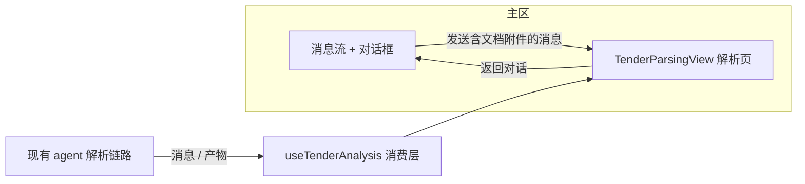

# 标书解析结果页设计方案：聊天发起、专门页面呈现结构化解析结果

## 1. 设计定位与阅读说明

本文解决：上传招标文件并开始解析后，解析过程与结果要在一个专门页面呈现（参考智标AI「招标解读」页形态），而不是留在聊天消息流或右侧栏。**本设计替代 D-20261028-1949**（A+B 摘要卡方案，确认后未实施，被本设计整体取代）。已确认的基调（2026-10-28 用户问答）：聊天（对话框）发起任务 → 之后的界面就是解析内容页；先做单步解析页（不做多步向导）；解析执行复用现有 agent 链路，前端负责结构化呈现。推荐阅读顺序：§2 背景 → §4 决策 → §5 详细设计（含数据契约草案）→ §8 验证。管理字段在 frontmatter 唯一维护；实施证据由 features 归档，不回填本文。

## 2. 背景、目标与范围

### 2.1 背景与问题

标书壳改造（D-20261027-2218）已完成侧边栏与欢迎页。当前解析体验：在聊天面板上传附件发消息，agent 产出以消息流 + 右侧 ToolPanel（进度/素材/产物/参考）呈现。用户提供的参考形态为专门解析页：

- 顶部「招标文件解析 * 以下两种方式任选一种」；两张方式卡：「招标文件自动解析」（选中态，注明自动解析招标文件、总结项目概述与评分要求，格式 doc/docx/pdf）与「粘贴项目信息解析」（占位）；自动解析卡带「历史记录」入口。
- 已上传文件卡：文件图标 + 文件名 + 大小 + 状态徽章（解析完成）+ 删除按钮。
- 结果区双栏：左「项目概述 *」（项目基础信息：项目名称/项目编号/预算金额/招标人/代理机构/开标日期/交付节点/项目地点/招标范围与规模等 bullet 列表），右「技术部分评分要求 *」（技术参数响应 bullet 列表）；每个区块卡右上角绿色对勾表示该区块解析完成。
- 解析中浮层提示「AI分析中，请稍候…」。
- 底部向导按钮：「上一步 / 下一步」。

已核实事实（2026-10-28 调研）：

1. 附件链路与发送：InputArea 附件面板（回形针/拖拽）产出 `AttachmentDraft`（含 `filename`、`size`、`kind`，document 类即 doc/docx/pdf 等），随消息提交。
2. agent 产出通道：聊天消息（markdown 文本）与产物文件（`useSessionArtifacts()`，含 `name`、`downloadUrl`）；两者均按 sessionId 隔离。
3. 主区视图切换有既有先例：消息流与 composer 由 `ChatPanel/index.tsx` 条件渲染；`display:none` 保挂载的做法已在 D-20261028-1949 评审中确认可接受（该结论沿用，方案本体被替代）。
4. 后端与 agent 提示词/技能链路不在本仓前端范围内；解析输出格式当前未结构化（待核实，见 §3 假设）。

问题：缺少"上传→解析→结构化结果页"的专门呈现，用户视线需在消息流与右栏之间来回。

### 2.2 目标与关键场景

| 场景 / 触发条件 | 当前行为 | 目标行为 / 可观察变化 |
| --- | --- | --- |
| 欢迎页/工作台上传招标文件并发送 | 留在聊天消息流，结果混在消息里 | 主区切换为「标书解析页」：头部 + 方式卡 + 文件卡（解析中徽章）+ 结果区骨架，浮层提示"AI分析中" |
| 解析进行中 | 右栏进度 tab | 解析页文件卡显示「解析中」；结果区块随产出渐进出现，完成区块打绿勾；右栏维持现状（不自动弹出，详见 D-06） |
| 解析完成 | 消息流出现长文本结果 | 文件卡转「解析完成」徽章；项目概述/技术部分评分要求等区块完整呈现，全部绿勾 |
| 解析结果浏览 | 翻消息/右栏产物 | 解析页双栏卡片直读；可滚动查看完整区块 |
| 返回对话 | — | 解析页提供返回入口，回到消息流（消息流保挂载，滚动/草稿不丢）；再次进入解析页状态保持 |
| 普通闲聊（无文档附件）发送 | 聊天流 | 维持聊天流，不进入解析页 |
| 点上一步/下一步 | 无此元素 | 本期占位：上一步=返回对话；下一步=禁用占位（后续向导预留） |

### 2.3 本次范围与非目标

- 本次包含：解析页整体布局与组件（头部/方式卡/文件卡/结果双栏/底部按钮）；进入与返回的视图切换；解析中与完成的状态呈现；前端数据契约消费（§5.3 草案 + markdown 兜底抽取）；i18n 双语；`data-testid`；受影响测试更新。
- 本次不包含：
  - 「粘贴项目信息解析」通道的真实功能（方式卡占位，禁用态）；
  - 「历史记录」真实功能（入口占位）；
  - 多步向导（下一步仅占位）；
  - agent/技能/提示词侧为对齐产出契约的改动（列为依赖，见 §3 与 §6.2）；
  - 后端、Gateway、AgentServer 任何改动；
  - D-20261028-1949 的摘要卡与大视图（被本设计替代，不实施）；
  - 移动端专属布局。

### 2.4 术语与上下文

- **解析页**：`TenderParsingView`（新组件），主区内与消息流互斥的全宽视图。
- **区块（section）**：结果页的最小呈现单元（如 项目概述 / 技术部分评分要求），带完成绿勾。
- **分析契约**：agent 解析产出的结构化载体约定（§5.3，草案），前端按契约渲染区块。

## 3. 设计约束、假设与待决问题

- 已确认约束与依赖：
  - 颜色只用 `var(--color-*)` 语义变量；新文案 zh/en 双语；新元素加 `data-testid`。
  - 解析执行复用现有 agent 聊天链路（用户已确认），前端不新增后端接口。
  - 消息流与解析页互斥显示、保挂载（沿用 D-20261028-1949 评审结论）。
- 关键假设：
  - agent 解析产出可引导为结构化格式（§5.3 契约草案）。若暂不可控，前端以 markdown 标题抽取兜底，呈现粒度降级为"按标题分块的文本"，页面结构不变。核实方式：实施前用真实招标文件跑一次现有解析链路，检查最终消息/产物格式。
- 待决问题：
  - **Q1 区块清单**：参考图只展示「项目概述」「技术部分评分要求」两个区块；是否还需要商务部分评分要求、资格要求等更多区块？影响契约默认区块集。倾向：契约支持任意区块数组，前端按到达顺序渲染，区块集由 agent 产出决定，不硬编码。
  - **Q2 重新解析/删除文件**：文件卡删除按钮的语义（仅清除页面状态重新上传，还是同时删除会话附件与结果）。倾向：删除=清空当前解析页数据并返回对话发起态，不动会话历史消息。

## 4. 总体方案与设计取舍

### 4.1 方案概览



用户在对话框上传招标文件并发送（触发条件 D-01）→ 主区从消息流切换为解析页（D-02）→ 前端消费层按契约草案读取 agent 产出（JSON 产物优先、markdown 标题抽取兜底，D-03）→ 区块渐进呈现、完成打勾（D-04）→ 底部向导按钮占位（D-05）。

### 4.2 关键决策

#### D-01 进入解析页的触发条件：提交含 document 类附件

- 选择与依据：用户明确"对话框发起任务，之后的界面就是解析的内容"；解析页是文件驱动的，以"本次提交含至少一个 document 附件"为触发，普通闲聊不进入，避免打断对话。
- 代价与成立条件：标书系统内用户若只发文字追问解析细节，会留在聊天流（符合直觉）；附件类型判定沿用 `resolveAttachmentKind`。
- 实现体现：§5.2 `ChatPanel/index.tsx` 提交钩子；验证 V-01/V-06。

#### D-02 解析页与消息流互斥显示、保挂载

- 选择与依据：解析页需要全宽双栏布局；消息流 `display:none` 隐藏不卸载，返回后滚动位置/草稿/展开态保留（沿用 D-20261028-1949 已确认结论）。
- 代价与成立条件：解析页打开期间看不到新消息流（解析进度在页面内呈现，可接受）。
- 实现体现：§5.6 状态机；验证 V-03。

#### D-03 数据契约：JSON 产物优先 + markdown 标题抽取兜底（契约草案）

- 选择与依据：用户确认"复用 agent 解析"。agent 产出当前为自由文本消息/产物，前端结构化呈现需要契约。定义 `tender-analysis.json` 产物契约（§5.3 草案）为首选通道；未产出契约文件时，回退抽取最终助手消息的 markdown 标题区块（`## 项目概述` 等已知标题集映射）。
- 代价与成立条件：兜底抽取对标题措辞敏感，仅保证已知标题集；契约对齐需 agent/技能侧配合（本期不做，列依赖）。
- 实现体现：§5.3、§5.2 `useTenderAnalysis`；验证 V-04/V-05。

#### D-04 区块渐进完成态

- 选择与依据：参考图每区块绿勾 + "AI分析中"提示；契约中区块带 `status`，前端按 status 渲染绿勾/骨架，整体解析中显示浮层提示。
- 代价与成立条件：兜底通道（markdown）无增量 status，退化为"解析完成后一次性全勾"；契约通道支持渐进。
- 实现体现：§5.2 `TenderResultSection`；验证 V-02。

#### D-05 向导按钮占位

- 选择与依据：本期单步页面；「上一步」= 返回对话，「下一步」禁用占位（tooltip 说明后续开放），为后续多步向导预留位置。
- 实现体现：§5.2；验证 V-01。

#### D-06 右栏维持现状

- 选择与依据：A+B 设计被替代后，不再做右栏抑制改造；ToolPanel 维持现有默认行为（不自动弹出逻辑不变），避免无关回归。
- 实现体现：无改动；回归 V-07。

### 4.3 替代方案与排除理由

| 候选 / 关联决策 | 候选目的与关键差异 | 拒绝或暂缓原因 | 重新评估条件 |
| --- | --- | --- | --- |
| R-01 D-20261028-1949（A+B 摘要卡）/ 全局 | 过程信息并入主区（摘要卡+大视图） | 用户明确以专门解析页替代；该设计未实施，替代零代码成本 | 若解析页形态不满足过程感知需求，可复活其摘要卡作为解析页内嵌元素 |
| R-02 解析结果留在消息流内嵌卡片 / D-02 | 不打断对话流 | 结构化结果双栏直读是核心诉求，消息流宽度与滚动形态不匹配 | 不适用（需求明确） |
| R-03 多步向导一次到位 / D-05 | 按参考产品做完整向导 | 用户明确先做单步解析页；后续步骤定义未提供 | 用户提供后续步骤定义后 |

## 5. 详细设计

### 5.1 模块责任与关键不变量

- `components/ChatPanel/TenderParsingView.tsx`（新增）：解析页容器（头部/方式卡/文件卡/结果区/底部按钮）。
- `components/ChatPanel/useTenderAnalysis.ts`（新增 hook）：按 sessionId 消费契约产物与消息兜底，产出 `TenderAnalysisModel`（文件信息 + 区块数组 + 整体状态）。
- `ChatPanel/index.tsx`：提交时判定触发条件并置 `tenderParsingOpen`（会话级 UI state）；互斥渲染消息流/解析页。
- 复用组件：文件图标 `FileIcon`；区块渲染纯展示。

关键不变量：

1. 解析页数据只读，不在页面内修改会话事实；删除文件卡仅重置页面态（Q2 倾向项，待确认）。
2. 普通文字消息提交不进入解析页；已打开解析页的会话，新消息到达不强制切走。
3. 无契约产物且消息兜底也无匹配标题时，结果区显示"等待解析产出"空态，不报错。
4. 全部新文案双语；新元素有 `data-testid`（前缀 `chat-tender-parsing-*`）。

### 5.2 关键组件设计

| 组件 / 所属模块 | 变更类型 | 职责与边界 | 组合关系 |
| --- | --- | --- | --- |
| ChatPanel/TenderParsingView.tsx | 新增；内部 | 页面装配：头部（标题+说明）、方式卡×2、历史记录占位、文件卡、结果区双栏、底部按钮 | 消费 `useTenderAnalysis`；回调 onBack（返回对话）、onReset（删除文件卡） |
| ChatPanel/TenderResultSection.tsx（可并入上者文件内） | 新增；内部 | 单区块卡片：标题 + 必传 `*` + 绿勾（status=done）+ 内容（kv/bullets/paragraph）/ 骨架 | 纯受控 |
| ChatPanel/useTenderAnalysis.ts | 新增；内部 | 契约读取：监听 artifacts 中 `tender-analysis.json`（经 downloadUrl 拉取解析）；兜底：扫描最终助手消息 markdown 标题集；输出 `TenderAnalysisModel` | 消费 `useSessionArtifacts`、`useChatStore` |
| ChatPanel/index.tsx | 修改 | `tenderParsingOpen` state；提交钩子（含 document 附件 → open）；互斥渲染 | — |

解析页布局（对应参考图）：

```text
┌────────────────────────────────────────────────────────────┐
│ 招标文件解析 *  以下两种方式任选一种            [返回对话]  │
│ ┌───────────────────┐ ┌───────────────────┐                │
│ │ ↑ 招标文件自动解析 │ │ ▣ 粘贴项目信息解析 │ [历史记录·占位] │
│ │   (选中态+格式说明)│ │   (禁用占位)       │                │
│ └───────────────────┘ └───────────────────┘                │
│ ┌ 文件卡 ────────────────────────────────────────────┐    │
│ │ [icon] xx招标文件.docx  165.83KB   [解析中/解析完成] 🗑 │    │
│ └─────────────────────────────────────────────────────┘    │
│ ┌ 项目概述 * ✓ ────────────┐ ┌ 技术部分评分要求 * ✓ ──────┐ │
│ │ 项目基础信息              │ │ 技术部分                    │ │
│ │ • 项目名称：…             │ │ • 分值：/                   │ │
│ │ …                        │ │ • 检测试剂为国产试剂…        │ │
│ └──────────────────────────┘ └────────────────────────────┘ │
│              [ < 上一步 ]   [ 下一步(禁用) ]                 │
└────────────────────────────────────────────────────────────┘
解析中浮层：「AI分析中，请稍候…」
```

### 5.3 接口定义与消息契约（草案）

**分析契约产物 `tender-analysis.json`（草案，目标约定）**：agent 解析完成后写入会话产物；前端经 `useSessionArtifacts` 发现 + `downloadUrl` 拉取。

```json
{
  "version": 1,
  "file": { "name": "承德招标文件20241226123915.docx", "size": 169813 },
  "status": "parsing | done | error",
  "sections": [
    {
      "key": "projectOverview",
      "title": "项目概述",
      "required": true,
      "status": "done",
      "blocks": [
        { "type": "heading", "text": "项目基础信息" },
        { "type": "kv", "label": "项目名称", "value": "承德市中心血站艾滋病防治血液类试剂采购项目" },
        { "type": "bullets", "items": ["采购乙型肝炎病毒…共100盒"] }
      ]
    },
    {
      "key": "techScoring",
      "title": "技术部分评分要求",
      "required": true,
      "status": "pending",
      "blocks": []
    }
  ]
}
```

| 字段 | 类型、必填与默认值 | 约束 | 语义 |
| --- | --- | --- | --- |
| version | number，必填 | =1 | 契约版本，前端按版本解析 |
| status | string，必填 | parsing/done/error | 整体状态；驱动文件卡徽章与"AI分析中"浮层 |
| sections[] | array，必填 | 至少 1 个 | 渲染顺序即数组顺序；区块集由产出决定（Q1 倾向项） |
| sections[].status | string，必填 | pending/done/error | 绿勾=done；pending=骨架 |
| blocks[].type | string，必填 | heading/kv/bullets/paragraph | 覆盖参考图内容形态 |

兜底通道（无契约产物时）：扫描最后一条助手消息的 markdown，`## 项目概述` / `## 技术部分评分要求`（及常见别名）映射为同名区块，正文按 `- ` 列表与 `**label**：value` 行转 bullets/kv；仅当消息不再流式增长时执行一次。

### 5.6 状态机与生命周期

会话级 UI state `tenderParsingOpen`（内存态，不持久化）：`closed → open（提交含 document 附件）→ closed（返回对话 / 删除文件卡）`；会话切换强制按新会话重算（store 均按 sessionId 隔离）。解析整体态（来自契约/兜底）：`parsing → done | error`；error 时文件卡显示失败徽章，结果区保留已产出区块。

### 5.7 正常执行流程

1. 用户上传招标文件并发送；提交钩子检测到 document 附件 → `tenderParsingOpen=true`，消息流隐藏、解析页显示。
2. `useTenderAnalysis` 开始监听：文件卡立即显示（附件本地信息），徽章=解析中，浮层提示"AI分析中"。
3. agent 产出到达：契约产物出现则按 sections 渐进渲染；否则等最终消息落定后兜底抽取。
4. 全部区块 done 或整体 status=done → 徽章转「解析完成」，浮层消失。
5. 用户可滚动浏览、返回对话（状态保留）、或点删除重置页面后重新上传。

### 5.8 异常、中断与重试处理

- 解析中断/失败：契约 status=error 或会话停止且兜底无产出 → 文件卡失败徽章 + 结果区保留已有区块，提示可返回对话重试。
- 重复上传：解析页打开态再次发送新文件 → 重新进入 parsing 态，区块重置（以最新一次提交为准）。
- 契约文件损坏（JSON 解析失败）：按"无契约"走兜底通道，不报错中断。

### 5.11 按需专项设计

- 视觉：页面容器白卡片、圆角与参考图对齐；选中方式卡浅蓝底（用 `--color-action-primary` 派生变量）；绿勾用 `--color-feedback-success`；双栏 `grid-template-columns: 1fr 1fr`（窄视口降为单列）。
- i18n：`chat.tenderParsing.*`（标题、说明、方式卡、历史记录、状态徽章、AI分析中、上一步/下一步、占位 tooltip、空态），zh/en 同步。
- 观测：不新增埋点。

## 6. 影响面与实施设计

### 6.1 修改点与实施顺序

| 实施项 | 模块 / 文件 | 修改内容与责任 | 前置 / 验证 |
| --- | --- | --- | --- |
| I-01 | ChatPanel/useTenderAnalysis.ts（新） | 契约产物监听拉取 + markdown 兜底抽取 → TenderAnalysisModel | 无；V-04/V-05 |
| I-02 | ChatPanel/TenderParsingView.tsx + .css（新） | 页面装配与三态呈现（parsing/done/error） | I-01；V-01/V-02 |
| I-03 | ChatPanel/index.tsx | tenderParsingOpen state、提交触发钩子、互斥渲染、返回入口 | I-02；V-01/V-03/V-06 |
| I-04 | zh.json / en.json | `chat.tenderParsing.*` 双语 | 与 I-02 并行 |
| I-05 | 前端测试 | 触发判定、三态渲染、兜底抽取、互斥保挂载断言 | 全部；§8 |

### 6.2 文档同步

- spec：无既有契约变化；§5.3 为新增草案契约，agent/技能侧对齐产出格式属后续依赖（不阻塞页面壳与兜底通道）。
- 被替代设计：D-20261028-1949 标记 `superseded-by` 本设计，不实施。
- 开发计划：writing-plans 阶段产出任务分解，验收关联 §8。

## 7. 兼容与迁移

- 影响对象：聊天主区渲染分支（新增互斥分支）；既有消息流、ToolPanel 均不改行为。
- 回退边界：解析页为纯新增组件 + 一个触发钩子，摘除即回到现状；无数据迁移。
- D-20261028-1949 未实施即被替代，无遗留代码。

## 8. 验证设计与通过条件

| 验证 ID | 场景 / 前置 | 操作 | 预期 / 通过条件 | 层级 |
| --- | --- | --- | --- | --- |
| D-20261028-2054-V-01 | 会话无附件 | 发送纯文字消息 | 不进入解析页，维持聊天流 | 组件测试 |
| D-20261028-2054-V-02 | 提交含 docx 附件 + mock 契约产物（parsing→done） | 观察解析页 | 文件卡即时显示、徽章 parsing→完成、区块渐进出现并打勾、浮层消失 | 组件测试 |
| D-20261028-2054-V-03 | 解析页打开，消息流有滚动与草稿 | 返回对话→再次进入 | 滚动位置/草稿不丢；解析页状态保持 | 组件测试 + 人工 |
| D-20261028-2054-V-04 | 无契约产物，最终消息含已知 markdown 标题 | 兜底抽取 | 区块按标题集正确映射，kv/bullets 转换正确 | 单测（纯函数） |
| D-20261028-2054-V-05 | 契约产物 JSON 损坏 | 渲染 | 走兜底通道，不报错白屏 | 组件测试 |
| D-20261028-2054-V-06 | 真实招标文件走现有解析链路 | 端到端人工 | 解析页可用；记录兜底通道实际命中情况，作为契约对齐依据 | 人工联调 |
| D-20261028-2054-V-07 | 回归：既有聊天/右栏相关测试 | 跑受影响测试套件 | 无新增失败 | 既有测试 |

## 9. 设计风险与已知限制

### 9.1 设计风险

| 风险 / 触发条件 | 影响 | 应对 | 核实方式 |
| --- | --- | --- | --- |
| agent 产出格式不可控，契约短期落不了地 | 结构化呈现粒度降级 | 兜底通道保底；契约作为草案随 agent 侧迭代对齐 | V-06 实测现有产出格式 |
| 兜底抽取标题措辞漂移 | 区块映射缺失 | 标题集含常见别名；无命中时显式空态而非错渲染 | V-04 用例覆盖 |

### 9.2 已知设计限制

- 单步页面：上一步/下一步为占位，多步向导后续立项。
- 粘贴解析、历史记录为占位入口。
- 区块内容只读，不支持页内编辑（参考图的编辑能力不在本期）。

## 10. 按日期记录的评审与设计修订

| 日期 | 评审人 / 确认方 | 评审或修订主题 | 结论 | 修改与依据 |
| --- | --- | --- | --- | --- |
| 2026-10-28 | hezhibao | 解析呈现形态澄清（提供智标AI招标解读页参考图） | 聊天发起+页面呈现；先做单步解析页；复用 agent 解析；替代 D-20261028-1949（A+B 设计）；补充原话"对话框发起任务，之后的界面就是解析的内容" | 用户问答确认记录 |
| 2026-10-28 | hezhibao | 整稿评审 | 设计通过（approved），进入实施计划阶段 | 设计文档评审确认 |
| 2026-10-28 | hezhibao（以真实解析产出为证据） | 兜底抽取规则修订 | 实测 agent 最终消息为任意 emoji 前缀 `## ` 标题 + GFM 表格 + 有序列表，且另产出 87KB 完整解析 md 文件；原"已知标题别名集"兜底全部落空。修订为：按任意 `## ` 标题通用切分、区块正文整体交 MarkdownRenderer 渲染、导语进 intro、会话产物文件进 outputs 下载区；无 `## ` 时整段单区块兜底 | §5.3 兜底通道语义以实现为准（tenderAnalysisModel.ts），本行记录修订依据 |

## 11. 参考与交接

- 关联设计：D-20261027-2218-tender-document-frontend-rework（标书壳改造）；本设计替代 D-20261028-1949-tender-inline-process-workspace（未实施）。
- 开发交接：范围 §2.3；关键决策 §4.2（D-01~D-06）；待确认 Q1/Q2（§3，均有倾向项，不阻塞开工）；契约草案 §5.3；验收 §8。
- 关联实施归档：尚无。
