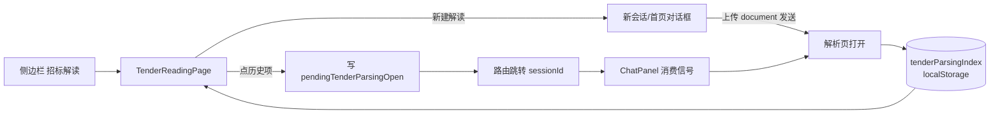

# 招标解读功能页设计方案：入口接线、历史记录与解析会话索引

## 1. 设计定位与阅读说明

本文解决：侧边栏「招标解读」目前是占位页；解析结果页（D-20261028-2054）只能在发送附件的当下出现，无法回看历史解析。本设计把「招标解读」落地为真实功能页，并沉淀**场景会话索引**底座（哪个会话解析过哪份文件），供我的标书/标书写作复用。已确认基调（2026-10-28 用户问答）：P0 三项（招标解读收尾、我的标书、标书写作）为首期范围。推荐阅读顺序：§2 背景 → §4 决策 → §5 详细设计 → §8 验证。管理字段在 frontmatter 唯一维护；实施证据由 features 归档。

## 2. 背景、目标与范围

### 2.1 背景与问题

已核实事实（2026-10-28 调研）：

1. 侧边栏 9 个标书域入口（`SessionSidebar/index.tsx` mainNavItems）经 `App.tsx` 的 `TENDER_PLACEHOLDER_NAV_KEY_SET` 判断全部渲染 `PlaceholderLibraryPage` 占位页。
2. 解析结果页已实现：含 document 附件的提交置 `tenderParsingOpen=true`（`ChatPanel/index.tsx`），`useTenderAnalysis` 从会话消息推导文件卡 + 区块 + 产物；历史会话重进时该 state 为 false，解析页无入口可达。
3. 会话路由为自研 history 路由（`useChatRoute`，route.kind='chat' + sessionId）；`requestSessionNavigation` 承担跳转。
4. 面板态跨会话恢复有先例：`features/teamHistoryPanelRestore.ts`（`loadTeamHistoryPanelState`）。
5. 会话列表数据已有（会话 store / 历史），但"是否解析会话、解析的是哪份文件"无任何记录。

问题：招标解读入口无真实页面；已解析的会话无法识别与回看。

### 2.2 目标与关键场景

| 场景 / 触发条件 | 当前行为 | 目标行为 / 可观察变化 |
| --- | --- | --- |
| 点侧边栏「招标解读」 | 占位页"功能规划中" | 真实功能页：「新建解读」引导卡 + 历史记录列表 |
| 点「新建解读」 | — | 跳转新会话（首页对话框），用户上传招标文件发送后即进入解析页（现有链路） |
| 上传招标文件发送成功 | 解析页打开，但无记录 | 解析会话写入本地索引（sessionId + 文件名 + 大小 + 时间） |
| 历史记录列表 | 不存在 | 按时间倒序列出解析记录（文件名、大小、相对时间、会话标题） |
| 点历史记录项 | — | 跳转对应会话并直接打开解析结果页（消息流隐藏、解析页呈现） |
| 该会话 agent 尚未产出 | — | 解析页显示解析中/空态（现有行为），不报错 |

### 2.3 本次范围与非目标

- 本次包含：`TenderReadingPage` 功能页（新建入口 + 历史列表）；解析会话本地索引（写入 + 读取）；历史项重开解析页的跨组件信号；占位集合移除 `tenderReading`；i18n 双语；testid；测试更新。
- 本次不包含：
  - 「粘贴项目信息解析」通道（仍为占位禁用态）；
  - 历史记录的服务端持久化（本期 localStorage，单机单浏览器；多设备同步列入后续）；
  - 历史记录的删除/重命名（后续随我的标书的项目管理一并做）；
  - 我的标书、标书写作本体（各自独立设计）；
  - 后端任何改动。

### 2.4 术语与上下文

- **解析会话**：发生过含 document 附件提交的会话。
- **解析会话索引**：`tenderParsingIndex`（localStorage），sessionId → { fileName, size, updatedAt }，本设计新增的写入/读取层。
- **重开信号**：`pendingTenderParsingOpen`（内存态 map：sessionId → true），导航前写入、ChatPanel 消费后即清除。

## 3. 设计约束、假设与待决问题

- 已确认约束与依赖：颜色语义变量；文案双语；testid 前缀 `tender-reading-` / 复用 `chat-tender-parsing-`；不引入 React Router，走 `activeNav` + `useChatRoute`。
- 关键假设：
  - 历史消息中的 user document 附件与最终助手消息在会话重载后完整可用（`useTenderAnalysis` 的兜底抽取依赖其存在；既有会话恢复链路已验证过消息/产物恢复，本期以人工验证兜底）。
- 待决问题：
  - **Q1 索引规模上限**：localStorage 容量 5MB 量级，索引条目极小（<200B/条），按 500 条 LRU 截断是否可接受？倾向：是，超出清最旧。
  - **Q2 同名文件多次解析**：同一文件重传产生多条历史，按 sessionId 各记一条（不去重）。倾向：不去重，符合"每次解析是一条记录"的直觉。

## 4. 总体方案与设计取舍

### 4.1 方案概览

### 4.2 关键决策

#### D-01 解析会话索引：localStorage 内存映射 + 观察写入

- 选择与依据：不写后端。写入点放在"解析页打开且会话 id 已落地、文件信息可得"的观察效应里（ChatPanel 内 `useEffect` 监听 `tenderParsingOpen && activeSessionId 为真实 id && model.file`），避免在提交钩子处拿不到真实 sessionId 的问题。读取只在 TenderReadingPage。
- 代价与成立条件：换浏览器/清缓存记录丢失（本期接受，§2.3 已声明）；Q1 LRU 截断。
- 实现体现：§5.2 `tenderParsingIndex.ts`；验证 V-02/V-03。

#### D-02 历史项重开：内存信号 map + ChatPanel 消费

- 选择与依据：导航与打开解析页是两步（先切路由、后置 state），跨组件用最小信号通道：`pendingTenderParsingOpen` map（模块级 Map），TenderReadingPage 写入后跳转；ChatPanel 在 `activeSessionId` 变化效应中检查并消费（命中则 `setTenderParsingOpen(true)` 并删除该 key）。不污染 URL 与全局 store。
- 代价与成立条件：信号一次性，刷新页面后丢失（可接受：刷新后用户仍在会话页，可手动从招标解读重进）。
- 实现体现：§5.2；验证 V-04。

#### D-03 新建解读入口：跳新会话而非页内上传

- 选择与依据：上传/发送链路（拖拽、附件、agent 发起）全部在对话框，页内重建一套成本高且双路径难维护；本期入口卡跳新会话，用户上传即入解析页。
- 代价：多一次跳转；后续若需要页内直传再立项。
- 实现体现：§5.2 TenderReadingPage；验证 V-01。

#### D-04 占位集合收敛

- 选择与依据：`TENDER_PLACEHOLDER_NAV_KEYS` 移除 `tenderReading`，`App.tsx` 增加 `activeNav === 'tenderReading'` 渲染 `TenderReadingPage` 分支；结构测试 tenderShellNav 同步更新（8 项占位断言）。
- 实现体现：§6.1 I-04；验证 V-05。

### 4.3 替代方案与排除理由

| 候选 | 差异 | 拒绝原因 | 重评条件 |
| --- | --- | --- | --- |
| R-01 索引写后端 runtime_state | 多端可同步 | 本期后端零改动约束；单机场景先行 | 资料库后端落地时随其迁移 |
| R-02 重开信号走 URL query（?view=parsing） | 刷新可恢复 | 自研路由的参数语义需扩展，收益小 | 用户反馈刷新后需直达解析页 |
| R-03 页内嵌上传直接建会话 | 少一次跳转 | 双重上传链路维护成本，本期不做 | 入口跳转被反馈为断点 |

## 5. 详细设计

### 5.1 模块责任与关键不变量

- `features/tender/TenderReadingPage.tsx`（新增）：功能页装配（新建卡 + 历史列表）。
- `components/ChatPanel/tenderParsingIndex.ts`（新增，纯函数 + localStorage 读写）：索引读写、LRU 截断；node:test 可直测。
- `components/ChatPanel/tenderParsingOpenIntent.ts`（新增）：模块级 `Map<string, true>`，write/consume 两个函数。
- `ChatPanel/index.tsx`：观察效应写索引；会话切换效应中消费重开信号。
- `App.tsx` / `frontendPlatform.ts`：`tenderReading` 出占位集合、挂真实页面。

关键不变量：

1. 索引只在"解析页真实打开过"时写入（避免误传附件未解析的会话进历史）。
2. 重开信号一次性消费，不重复触发。
3. 索引读写异常（满/坏 JSON）不阻塞任何主流程。
4. 新文案双语、新元素 testid。

### 5.2 关键组件与函数

| 组件 / 模块 | 变更类型 | 职责 | 备注 |
| --- | --- | --- | --- |
| ChatPanel/tenderParsingIndex.ts | 新增 | `readTenderParsingIndex(): TenderParsingIndexEntry[]`（按 updatedAt 倒序）；`upsertTenderParsingIndex(entry)`（同 sessionId 覆盖，500 条 LRU）；`TenderParsingIndexEntry = { sessionId, fileName, size?, updatedAt }` | 纯函数 + storage 注入，node:test 直测 |
| ChatPanel/tenderParsingOpenIntent.ts | 新增 | `markTenderParsingOpen(sessionId)` / `consumeTenderParsingOpenIntent(sessionId): boolean` | 模块级 Map |
| features/tender/TenderReadingPage.tsx + .css | 新增 | 新建解读卡（点击 → `onNew()` 跳新会话）；历史列表（文件名/大小/相对时间，点击 → 写信号 + `onOpen(sessionId)`） | props 注入导航回调，保持可测 |
| ChatPanel/index.tsx | 修改 | 两个效应：①`tenderParsingOpen && activeSessionId!==NEW_CONVERSATION_ID && tenderAnalysis.file` → upsert 索引；②会话切换效应内 `if (consumeTenderParsingOpenIntent(activeSessionId)) setTenderParsingOpen(true)`（放在关闭逻辑之前） | 消费顺序：先消费信号，再走关闭判断 |
| App.tsx / frontendPlatform.ts | 修改 | `tenderReading` 渲染 TenderReadingPage；占位集合减一 | 结构测试同步 |

历史列表项形态：`[FileIcon] 承德招标文件….docx  165.8 KB · 3 小时前`；空态：插图 +「暂无解读记录，上传招标文件开始第一次解读」。

### 5.5 数据模型与事实归属

| 数据 | 语义 | 权威位置 | 生命周期 |
| --- | --- | --- | --- |
| tenderParsingIndex | 解析会话索引 | localStorage（单浏览器） | 写入：解析页打开且会话落地；截断：500 条 LRU；清除：本期不提供 UI |
| pendingTenderParsingOpen | 重开信号 | 模块级 Map（内存） | 写入→消费即删；页面刷新丢失 |

### 5.6 状态机与生命周期

重开链路：`TenderReadingPage.click(item)` → `markTenderParsingOpen(sessionId)` → `onOpen(sessionId)` 路由切换 → ChatPanel 挂载/会话切换效应 → `consumeTenderParsingOpenIntent` 命中 → `tenderParsingOpen=true` → 解析页呈现（数据由 `useTenderAnalysis` 从该会话历史消息重建）。

### 5.8 异常与边界

- 索引坏数据：read 时 JSON.parse 失败 → 返回空数组，不抛错。
- 历史项对应会话已被删除/归档：路由跳转落到既有 not-found 分支，信号自然过期（不消费）。
- 同一文件重复解析：各记一条（Q2 倾向项）。

### 5.11 专项

- i18n：`tenderReading.pageTitle` / `newReading` / `newReadingDesc` / `historyTitle` / `historyEmpty` / `justNow` 等时间相对文案复用现有工具（若无相对时间工具则用绝对时间 HH:MM MM-DD）。
- 视觉：页面卡片沿用解析页视觉（白卡、圆角、语义色）。

## 6. 影响面与实施设计

### 6.1 修改点与实施顺序

| 实施项 | 模块 / 文件 | 修改内容 | 验证 |
| --- | --- | --- | --- |
| I-01 | tenderParsingIndex.ts（新） | 索引读写 + LRU | V-02 |
| I-02 | tenderParsingOpenIntent.ts（新） | 信号 map | V-04 |
| I-03 | TenderReadingPage.tsx/.css（新） | 功能页 | V-01/V-03 |
| I-04 | App.tsx / frontendPlatform.ts / 结构测试 | 占位收敛 + 挂页 | V-05 |
| I-05 | ChatPanel/index.tsx | 索引写入效应 + 信号消费 | V-02/V-04 |
| I-06 | zh.json / en.json | tenderReading.* 双语 | V-05 |
| I-07 | 测试 | tenderParsingIndex 单测 + tenderShellNav 更新 + 结构断言 | §8 |

### 6.2 文档同步

- spec：无契约变化。
- 关联：D-20261028-2054（解析页）为本设计依赖；我的标书/标书写作设计将复用 I-01 索引底座。

## 7. 兼容与迁移

- 占位页集合减一，其余 8 项不受影响；`tenderReading` 的 nav 文案复用既有 `nav.tenderReading`。
- 回退：摘除 I-04 分支即恢复占位页，索引/信号文件为纯新增。

## 8. 验证设计与通过条件

| 验证 ID | 场景 / 前置 | 操作 | 预期 / 通过条件 | 层级 |
| --- | --- | --- | --- | --- |
| D-20261028-2254-V-01 | 点侧边栏「招标解读」 | 进入页面 | 功能页呈现：新建卡 + 历史列表（空态） | 结构测试 + 人工 |
| D-20261028-2254-V-02 | 上传 docx 发送、解析页打开、会话 id 落地 | 观察 localStorage | 索引新增一条（sessionId/fileName/size/updatedAt） | 单测（纯函数）+ 人工 |
| D-20261028-2254-V-03 | 已有 ≥1 条索引 | 进入招标解读页 | 历史列表按时间倒序展示文件名/大小/时间 | 组件结构 + 人工 |
| D-20261028-2254-V-04 | 点历史项 | 跳转会话 | 该会话主区直接呈现解析页（信号一次性，刷新不重复触发） | 人工 |
| D-20261028-2254-V-05 | 回归 | tenderShellNav / tenderParsing* / i18nLocales 测试 | 全部通过（占位断言更新为 8 项） | 既有 + 新测试 |

## 9. 设计风险与已知限制

- 风险：会话历史重载后兜底抽取依赖最终助手消息存在；若历史截断/缺失，重开的解析页呈空态。应对：V-04 人工验证覆盖；后续契约通道落地后优先读契约产物。
- 已知限制：索引单浏览器有效；无删除 UI；历史项标题为文件名而非项目名（项目名需从解析结果提取，随我的标书立项）。

## 10. 按日期记录的评审与设计修订

| 日期 | 评审人 / 确认方 | 评审或修订主题 | 结论 | 修改与依据 |
| --- | --- | --- | --- | --- |
| 2026-10-28 | hezhibao | 功能开发方案与首期范围 | 确认 P0 三项（招标解读收尾/我的标书/标书写作）；资料库允许后端存储（P1 范围） | 用户问答确认记录 |
| 2026-10-28 | hezhibao | 整稿确认 | 用户直接指示"开始实施"，设计通过（approved） | 用户指令 |

## 11. 参考与交接

- 关联设计：D-20261027-2218（壳改造）、D-20261028-2054（解析结果页，本设计依赖其视图与数据层）。
- 开发交接：范围 §2.3；决策 D-01~D-04；Q1/Q2 有倾向项不阻塞；验收 §8。
- 关联实施归档：尚无。
